# 不生成文本，模型如何做决定？从 Jev 原理到 NanoJev 与 SGLang 实验

> 本文是 [65 页网页 slide](slides/deck.html) 的长文版本，补充流程图、公式与实验解释。实验运行于 2026-10-06；正文区分官方公开说明、教学示意、上游历史记录和本次服务器实测。本文不包含 AI4-Loc 应用方案。

软件中的许多模型调用，最终只需要一个很小的判断：工单转给谁、某个动作是否安全、工具结果是否合格、下一步继续还是转人工。让聊天模型先生成解释，再从文本中提取答案，是一种实现方式。Jev 提出了另一种产品形态：输入材料与类型化问题，直接返回可由程序使用的决策及概率。

这篇文章讨论两个问题：这样的接口改变了什么？当原版 Jev 暂时不可用于本次账号时，开源决策模型 NanoJev，以及 SGLang 的 System One 兼容接口，能让我们验证哪些东西？

先给出本轮观察：NanoJev 更贴合这批离线题的参考目标；同一个 Qwen 改用 System One 后，速度收益取决于聊天基线的输出预算；8 个完整任务没有显示质量提升，复跑累计模型请求耗时约低 11%。这些结果没有证明 NanoJev 的优势来自概率校准，也没有证明开源实现复现了原版 Jev。

## 1. 从生成回答到类型化判断

Jev 是 TypeSafe 的 typed decision model。它把答案空间提前写进接口，让调用者直接获得选择、分值或命题概率。这里的“System One”是产品与接口概念，不意味着模型实现了心理学意义上的人类直觉。

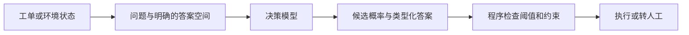

聊天接口通常还包含“生成文本 → 解析文本”的环节。决策接口把输出契约固定下来，使控制器可以直接消费数值。但结构化输出、推理速度、判断能力和概率可靠性是四件事，不能由其中一件自动推出另外三件。

Jev 发布时引起关注，slide 保留了当时的发布背景、创始团队和热度资料。它们属于历史介绍：热度、价格、免费额度和接入产品会变化，不能作为今天的部署承诺。本文关注能够解释机制和支撑实验结论的部分；历史数字与出处见 [技术事实核查](notes/技术事实核查.md)。

### 三种问题，三种输出

| 类型 | 适合的问题 | 如何使用结果 |
|---|---|---|
| `choice` | 转计费、技术还是销售？ | 获得候选分布，选择最大概率项或按策略分流 |
| `score` | 情绪处在哪个有序档位？ | 对档位概率取加权平均 |
| `noul` | 客户是否明确威胁投诉？ | 获取命题成立的概率 |

以下是教学输入，展示字段关系，不是一次新的 API 调用记录：

```json
{
  "state": "会员已付款但没有开通，客户要求今天处理，否则投诉。",
  "questions": {
    "team": {
      "type": "choice",
      "instructions": "应该由哪个团队处理？",
      "criteria": {
        "billing": "支付、退款和订阅问题",
        "technical": "功能故障和集成问题",
        "sales": "价格和套餐咨询"
      }
    },
    "complaint": {
      "type": "noul",
      "instructions": "客户是否明确表示要投诉？"
    }
  }
}
```

`state` 放待判断材料；问题说明判断目标；候选说明类别含义。程序仍然负责权限、业务约束和执行。某个模型返回 HTTP JSON，并不表示它通过逐 token 生成了这段 JSON：服务可以将数值读出结果序列化返回。反过来，响应里的 `output_tokens` 字段也需要结合实现解释，不能仅凭字段名推断内部计算。

对于 `score`，假设三个档位为 0、1、2，概率分别为 0、0.34、0.66，则期望分值为：

```text
score = 0 × 0 + 1 × 0.34 + 2 × 0.66 = 1.66
```

它表示档位分布的期望，不等于模型直接执行了连续回归。slide 中的 confidence 则是相对于均匀分布归一化的最大概率：`(p_max - 1/K) / (1 - 1/K)`。它不是另一份独立校准证明；更不能直接把 confidence 当作这个动作成功的概率。具体字段语义应按对应服务版本核验。

## 2. 校准究竟是什么？

校准讨论的是一批预测与实际结果的关系。假设模型对 100 个同类事件都报 0.8，如果这些事件约有 80 个实际发生，才支持这组预测在该概率区间比较可靠。它不保证某一次判断正确，也不意味着模型的首选动作一定更好。

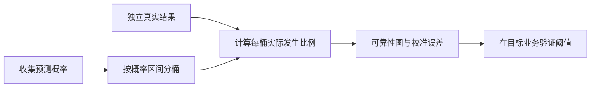

常用指标回答的问题并不相同：

| 指标 | 主要回答的问题 | 需要警惕什么 |
|---|---|---|
| 动作匹配率 / 分类准确率 | 首选动作是否匹配目标？ | 目标可能只是教师偏好 |
| ECE / 可靠性图 | 报出的把握与实际频率是否接近？ | 分桶方式、小样本和分布变化 |
| Log loss / Brier score | 概率预测整体质量如何？ | 同时涉及校准与区分能力，不能只解释成校准 |
| 环境成功率 | 策略是否完成真实任务？ | 控制器、预算和任务难度也会影响结果 |

在分布变化后，原先合理的概率可能失真。slide 中的历史第三方评测就体现了这种差异：某些域内任务概率较可靠，分布外任务和隐藏业务规则会明显变差。这些评测来自不同协议，不能合成一个统一排名，也不能替代本项目实测。

## 3. “一次判断”可能如何实现？

可以用“共享材料、独立问题分支、数值读出”的计算图理解这类服务。材料先编码，各题读取共同材料与自己的题干、候选，最后得到分数。

**下图是教学计算图，不是已公开的 Jev 内部结构。** 前缀缓存、分支隔离、决策位置和读出头能够解释部分黑盒行为，但不是唯一解释。Jev 的精确参数规模、是否 MoE、特殊 token 和完整读出设计，不能由探针唯一确定。

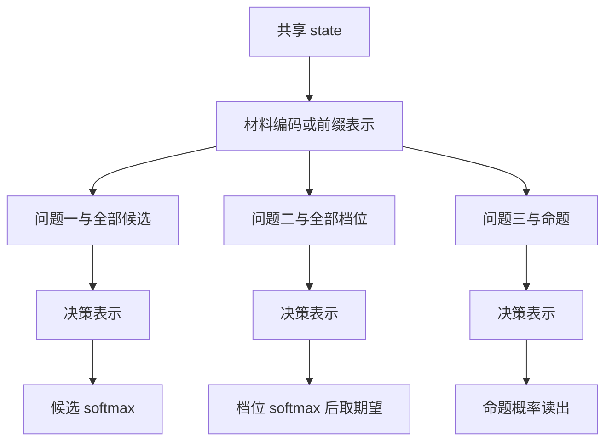

这里有一个容易混淆的区别：**题与题隔离，不等于同一道题的候选互相隔离。** 如果所有候选共同参与编码，添加“其他”或改变候选顺序，可能同时改变已有选项的相对分数。即使最后采用 softmax，候选集变化也不仅是分母增加了一项。

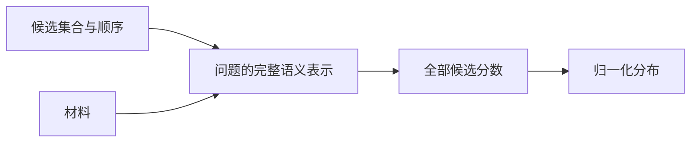

因此，评测需要固定候选说明与顺序，并记录它们的版本。多个问题若依赖前一个问题的答案，应用层应分轮组织，而不能默认同一请求中的问题会互相传递结果。

“不生成文本”也不等于计算量与输入无关。较长的材料增加 prefill 工作，大批量问题增加调度与计算成本。slide 的历史延迟探针支持这些现象；不能据此推出所有请求都维持固定的 100 ms。

## 4. RLHF、RLVR 和 RLCD：优化目标发生了什么变化？

这三条路线的区别在反馈来源和优化目标，不只是输出形式。它们可以出现在复杂训练流程的不同阶段，并非天然互斥。

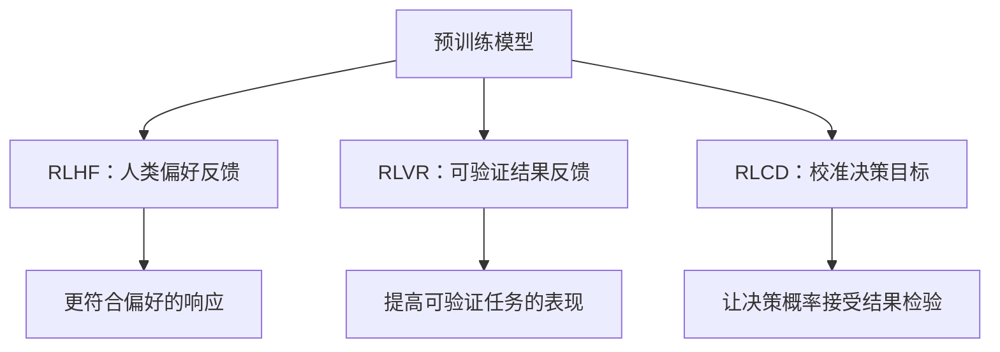

### RLHF：学习偏好

经典 InstructGPT 路线可以概括为监督微调、人类排序、奖励模型、策略优化。下图使用 PPO 与 KL 描述经典示例，不代表所有现代 RLHF 实现都采用同一算法。

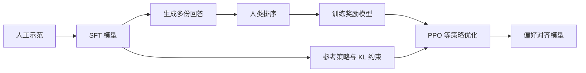

### RLVR：结果可验证

数学题或代码任务可以用规则检查结果。简化的 0/1 奖励告诉模型某次生成是否正确，却不直接要求它诚实报告完整概率分布。


### RLCD：让概率对结果负责

Jev 官方将训练路线称为 RLCD。为了理解校准目标，可以用 log loss 或 Brier score 举例：将模型的整份分布与真实结果或可信目标分布比较，而不只奖励一个被采样出来的正确答案。

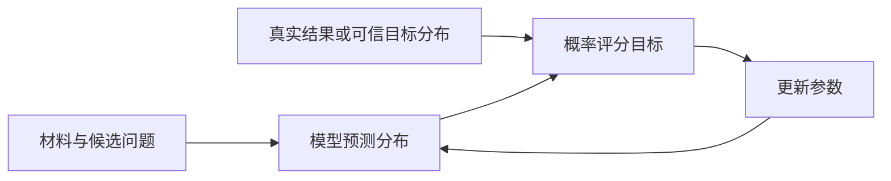

这个图解释“概率应该接受什么检验”，**不是 Jev 的真实训练配方**。官方完整损失、优化器、奖励组合和训练代码未由本项目掌握。不能把这里的教学示例说成 Jev 已确认采用的算法，也不能把 RLCD 写成 RLVR 的别名。

## 5. 合成数据为什么重要，又为什么不够？

slide 引用的官方采访强调合成训练数据，以及“统计上被充分理解”的数据生成。这一口径涉及所讨论的训练数据，不能扩张成底座预训练语料也全部由同一方式产生。

一种帮助理解的教学重构是：先抽取潜在结果，再按规则生成可见材料，最后根据可见信息计算目标分布。


例如，设技术类先验为 0.45、计费类先验为 0.40；教学模拟器规定技术类提到集成失败的概率为 0.8、提到扣款问题的概率为 0.1，计费类对应为 0.1 和 0.7。**在类内条件独立且暂不考虑其他类别的示例假设下**，同时观察到两条线索时：

```text
技术权重 = 0.45 × 0.8 × 0.1 = 0.036
计费权重 = 0.40 × 0.1 × 0.7 = 0.028
归一化后：技术 56.25%，计费 43.75%
```

模拟器知道潜在类别，不代表模型根据文本就应该报 100%。文本可能隐藏或模糊信息；训练目标应对应可见信息条件下的分布。换一种措辞、删除关键线索或改变先验，都可能改变目标。

难点是这些生成规则未必符合真实世界。规则里“技术类有 80% 提集成失败”，真实业务可能只有 60%。即使模型完美学会模拟器，部署后仍可能系统性失准。可控合成数据解决了标签和覆盖的一部分问题，跨域验证仍然必要。

## 6. 历史展示应该怎样读？

slide 包含官方工作流评测、独立评测和开源轨迹。官方四个工作流历史汇总展示了低成本与低延迟的潜力，也显示不同工作流表现不一致。其参考标签包含其他模型答案，不能把所有数字都解释成独立人工真值上的准确率。官方表格中发票处理也落后于部分比较对象，说明决策接口不能消除任务能力差异。

独立评测同样提醒我们：短文本分类、专业意图识别、需要复杂推理的任务，以及分布外任务，不能放进一个能力口号里。历史结果的模型版本、样本和提示不同；详细表格仍见 slide 第 35–38 页和 [出处核查](notes/技术事实核查.md)。这里不把旧结果重新包装为本轮实测。

Minecraft 案例提供了另一种提醒：演示成功可能同时来自规划模型、预设路线、环境观察器和控制器。slide 第 39 页对应的静态分析发现，不少调用只有一个候选动作，工程脚本承担大量行为约束。它支持“审计模型实际做了哪些选择”，不能在缺少消融时把通关主要归功于决策模型。详细证据见 [代码分析报告](../../experiment/jev_practice/results/minecraft-agent-debunk.md)。

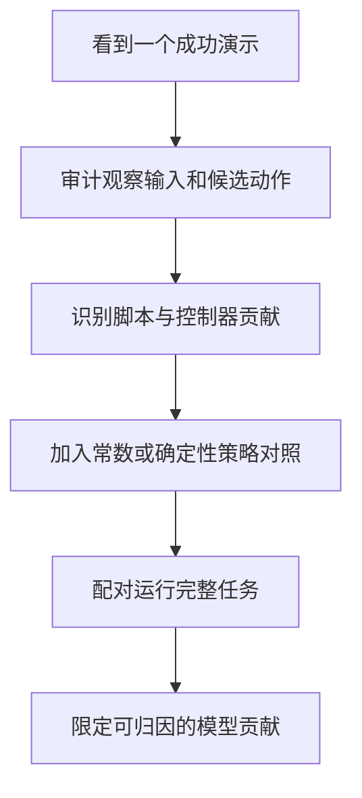

### NanoJev 迷宫回放：225 次尝试说明了什么？

上游展示轨迹中，Jev 为 2,738 次尝试、1,044 次撞墙，NanoJev 为 225 次尝试、77 次撞墙。这是两条历史轨迹的行动成本，不是本机推理计时，不能写成“快了 12 倍”。

控制器会先选择未试过且概率至少为 0.5 的方向，再按距离、访问次数与概率排序；失败后记墙，必要时沿已知边回退。审计发现 NanoJev 记录中的 572 个方向概率全部超过 0.5，最低仍为 0.688。门槛没有排除任何记录方向，因此路线差异需要结合排序与控制器理解。

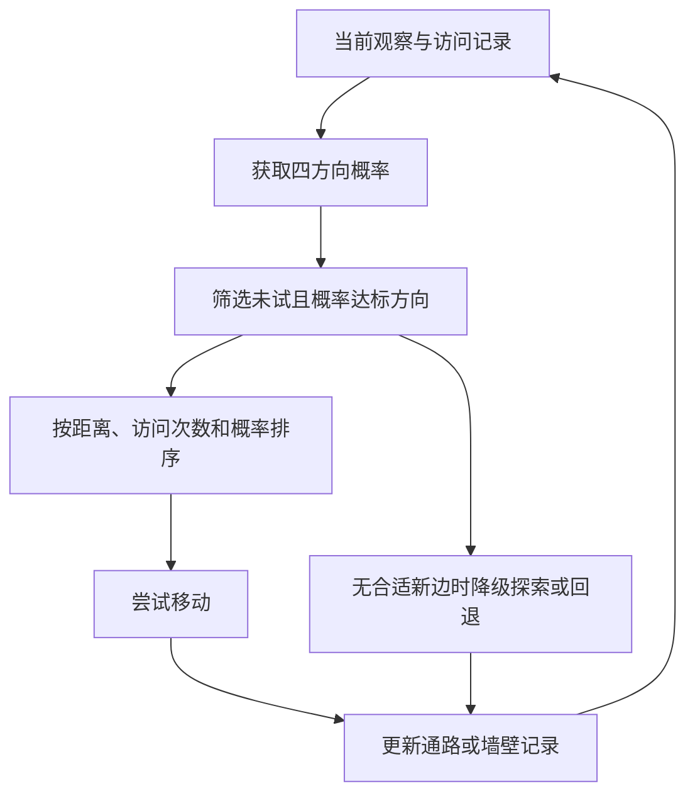

在相同地图和控制规则下，本地常数 `p=0.5` 对照只需 162 次尝试、34 次撞墙。这不证明常数策略普遍更强，却说明这个展示不足以证明模型优越性。另一个独立的上游 10 案例 Maze 测试中，NanoJev 和 Jev 分别成功 4/10、7/10；该测试与展示的控制设置不同，不能拼成同一张排名表。

## 7. Jev、NanoJev、SGLang Jev-like：共性与差别

本轮用户账号尚未获得 Jev API 权限。因此新的服务器实测包含 NanoJev 与 SGLang，不包含新调用的原版 Jev。不能把账号条件写成“所有用户都无法申请”，也不能以教师一致率冒充 Jev 在线比较。

| 维度 | TypeSafe Jev | NanoJev | SGLang Jev-like |
|---|---|---|---|
| 定位 | 官方类型化决策服务 | 社区开源决策模型 | 通用生成模型的决策接口 |
| 本轮模型 | 未新增在线调用 | Qwen3-0.6B 底座与决策头 | Qwen3.8-27B 原权重 |
| 训练信息 | 官方称 RLCD，完整配方未公开 | 发布权重接受任务监督与教师目标训练 | 本轮未新增训练 |
| 概率来源 | 内部完整实现未公开 | 候选编码与决策读出 | 回答位置的候选标签分数 |
| 校准证据 | 官方目标，仍须按任务验证 | 本轮未做独立校准评估 | 归一化分数不自动具有校准性 |
| 可核验范围 | 公开接口与资料、历史记录 | 源码、发布权重、本轮推理 | 服务源码、固定权重、API 响应 |

NanoJev 的本次模型约为 **0.6B**，不是 0.5B。它让候选路径经过共享底座编码，再通过决策头与集合交互得到评分；本轮加载的是已发布 unified checkpoint，没有重新训练。

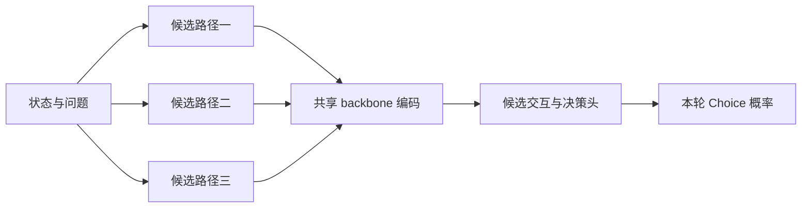

上图是本次实现层面的概括。早期迷宫展示中四个独立方向安全概率，与本轮 Choice 的 softmax 候选分布，语义并不相同，不能要求前者也一定总和为 1。

SGLang 的路径则保留聊天模型原有词表输出头，将选项映射到单 token 标签，在回答位置读取分数。兼容接口改变了服务输出方式，不等于对 Qwen 进行了 Jev 的决策训练。


在候选内做 softmax，可以得到总和为 1 的分布，但它表示的是标签评分。`label_mass` 描述整个词表概率中落在指定标签上的质量，也不是动作正确率。接口相似，使它们能接入类似控制器；它不证明内部计算、训练目标或概率语义完全相同。

本轮使用 `/v1/systemone`。SGLang 官方另有原生 `/v1/decisions`；版本与模型模板检查会影响可用性。部署时应固定服务版本、检查标签 token 和实际渲染提示，不能只看 endpoint 名称。具体机制与限制见 [SGLang 官方文档](https://docs.sglang.io/docs/supported-models/decision_models#system-one-compatible-api)，本轮环境见 [部署记录](../../experiment/sglang_systemone/README.md)。

## 8. 三层实验，隔离三个问题

本轮服务器为 A100-SXM4-80GB 单卡，SGLang 0.5.21，Qwen3.8-27B BF16。NanoJev 以 FP32 权重驻留、BF16 autocast 运行；运行依赖与上游 requirements 存在差异，详见 [实验环境与版本](../../experiment/nanojev_compare/README.md)。

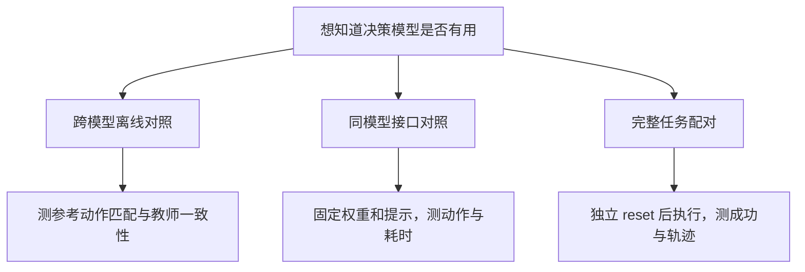

第一层混合了训练、容量和编码方式，只能比较这两个部署实例。第二层保持同一 Qwen，才能讨论接口改变的影响。第三层让策略真正运行，才能评价环境结果。三者的指标不能相互代替。

### 8.1 离线对照：NanoJev 更贴合参考目标

从上游 test/OOD 数据按 ID 的 SHA-256 排序，按任务、划分抽不同 episode；最多各取 30 个，不足则全部纳入。最终 96 条，不是全量 4,438 条数据。两模型接收相同状态、问题和候选，教师概率不作为输入。

| 划分 / 任务 | 题数 | NanoJev | SGLang Jev-like | 指标 |
|---|---:|---:|---:|---|
| test / 射击 | 30 | 73.3% | 13.3% | 专家首选动作匹配 |
| OOD / 射击 | 30 | 83.3% | 26.7% | 专家首选动作匹配 |
| test / 迷宫 | 10 | 70.0% | 10.0% | Jev 教师首选动作一致 |
| OOD / 迷宫 | 10 | 60.0% | 50.0% | Jev 教师首选动作一致 |
| test / 贪吃蛇 | 8 | 87.5% | 62.5% | Jev 教师首选动作一致 |
| OOD / 贪吃蛇 | 8 | 87.5% | 100.0% | Jev 教师首选动作一致 |

射击合计为 **47/60 对 12/60**；迷宫与贪吃蛇的教师一致合计为 **27/36 对 19/36**。不能把两种参考目标不加区分地合成“准确率”，也不能写成通关率。OOD 贪吃蛇上 SGLang 为 8/8，说明 NanoJev 也并非所有分组都领先。

本轮离线单题耗时中位数为 NanoJev 35.4 ms、SGLang 158.2 ms。前者为同进程调用，后者经过 localhost HTTP；模型大小、输入编码与精度也不同。它描述两套部署，不能作为公平的模型速度排名。

### 8.2 同一 Qwen：System One 是否更快？

三组共享 renderer、候选顺序和关闭 thinking 的模板。逐题输入 token 数相同；一个代表样本的完整 token ID 序列一致。完整审计范围应如此表述，不能扩张成所有题都逐 token 审计过。

| 组别 | 输出设置 | 相对 A 的动作一致 | HTTP 耗时中位数 |
|---|---|---:|---:|
| A：System One | 不生成文本 | 参照 | 85.7 ms |
| B：Chat | 贪心，最多 1 token | 96/96 | 57.5 ms |
| C：Chat | 最多 32 token，实际均值 2 | 95/96 | 119.7 ms |

它支持一个具体结论：**相对允许正常结束的短答，System One 在这批固定状态中更快；相对优化到一个 token 的 Chat，则更慢。** 32 是预算上限，不是实际生成了 32 个 token。

A 与 B 的行为高度相近也有机制上的合理性：同样的回答位置，贪心首 token 与候选标签评分，可能选中同一个标签。但并非所有模型和模板都必然如此，词表外质量、实现细节和近似计算都可能影响结果。

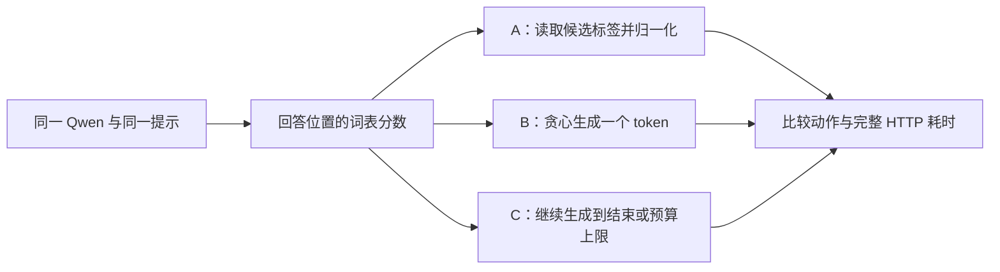

这些是小规模 pilot：每题一次测量，没有清空 prefix cache。C 的一条动作差异尚待确定性复查，不能随意归因。A/C 汇总匹配数相同，也不能掩盖逐题差异。计时到响应 JSON 读取完成，包含服务与 HTTP 路径，不是纯 GPU kernel 时间。

### 8.3 完整任务：质量相同，累计模型耗时有差

在迷宫和贪吃蛇上，A 与 B 对相同初始世界和种子分别 reset 后运行。每组 8 局；最长成功案例为 16×16 迷宫、149 个物理步骤。这里没有执行 800 步迷宫，也没有证明一般意义上的超长程规划能力。

| 复跑指标 | System One | 1-token Chat |
|---|---:|---:|
| 成功局数 | 6/8 | 6/8 |
| 物理步骤合计 | 555 | 555 |
| 实际模型调用 | 460 | 460 |
| 配对动作序列一致 | 8/8 对 | 8/8 对 |
| 累计模型 HTTP 耗时 | 107.71 s | 120.99 s |

物理步骤与模型调用不同，是因为代码可以沿已知边重定位；这些移动仍消耗物理预算。累计 HTTP 时间也不是整个任务的墙钟完成时间。

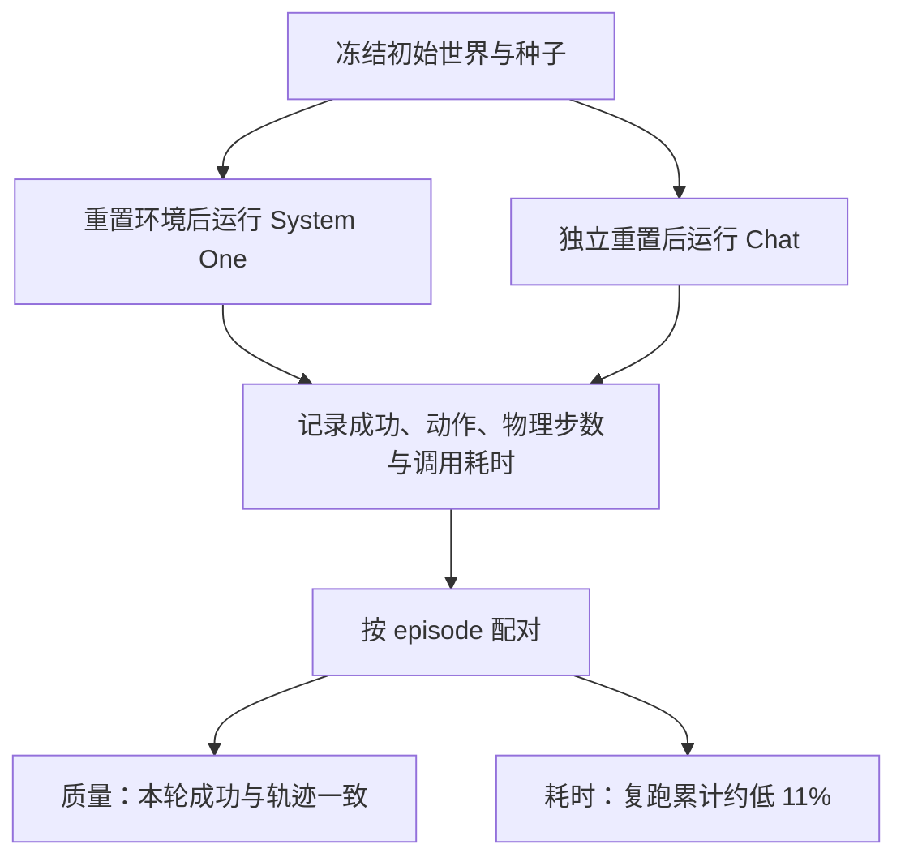

下降比例为 `(120.99 - 107.71) / 120.99 ≈ 11.0%`。说“两者完全没有区别”不准确；说“System One 明显改善长程判断”也不符合数据。更准确的说法是：**这 8 个任务没有显示质量提升，复跑累计请求耗时存在约 11% 差异，稳定性仍待验证。**

首轮 Chat 累计 194.45 秒受到一次审计请求重叠等因素干扰，因此不用来宣传性能。复跑期间没有其他模型请求，但缓存仍未严格控制。同样 8 个案例重复两轮，统计上也不是 16 个独立任务。

## 9. NanoJev 的优势是否来自校准？

这是值得研究的假设，尚不是本次结果。已知 NanoJev 接受了相关任务的专家与教师目标训练；通用 Qwen 只更换了接口。因此，任务监督与适配可以解释它为何更接近这批参考目标。

但本轮同时改变了底座、容量、输入编码和决策头，没有训练目标消融，也没有独立真实结果上的校准评价。我们不能从“0.6B 模型匹配率更高”反推“校准是唯一原因”。

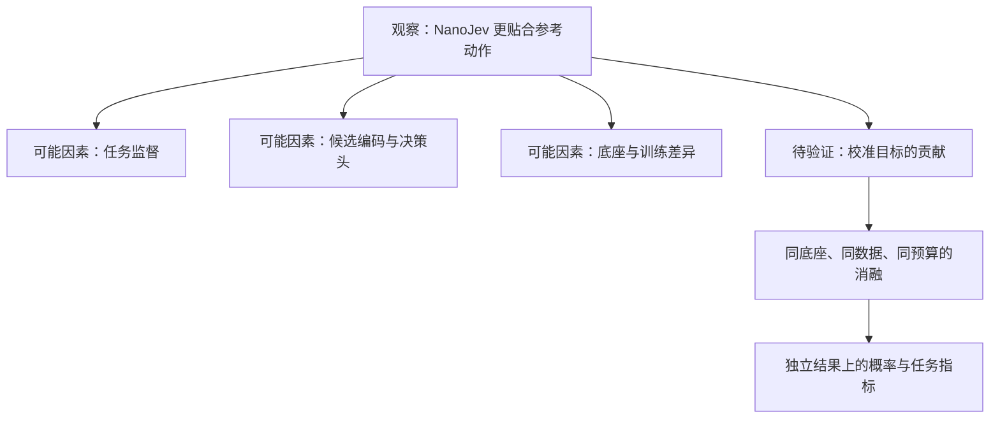

一个特别重要的区别是：对同一道题的 logits 做正温度缩放，通常不改变 argmax。因此，事后校准可以改善概率可靠性，而动作匹配率不变。校准与决策质量有关联，却不能直接画等号。

要推进这一假设，下一轮应固定底座、数据和预算，比较训练目标或是否加入校准处理，并在不参与训练和调参的真实结果上评估可靠性图、Brier、log loss，以及任务成功率。对于包含随机性的任务，还需要明确“结果概率”对应什么事件，避免把教师偏好误当世界真值。

## 10. 接口收益应该如何进一步验证？

当前实验已回答一部分机制问题，尚不足以给稳定性能排名。后续可以预先冻结新增 seed，按难度分层配对运行；episode 才是统计单位，不能把同一轨迹的几百个连续状态当作几百个独立样本。


应分别设计相同行动预算与相同墙钟预算。当前游戏时钟按 action 前进，网络等待不会消耗物理步数；降低延迟不一定改变同样步数内的成功率。但在真实有时限的系统里，它可能允许更多判断和重试。这是另一个需要实验检验的问题。

本轮没有完成上述正式扩展，不能把设计写成结果。已执行协议、脚本命令与未完成项见 [System One / Chat 实验协议](../../experiment/nanojev_compare/SYSTEMONE_VS_CHAT_PROTOCOL.md)。

## 11. 回到软件：模型判断与程序执行各做什么？

决策模型适合答案空间封闭、调用频繁、需要阈值和拒绝策略的环节。需要写代码、生成回答或提出新方案的环节，仍然需要生成能力。多步任务中，状态更新、记忆、权限与终止条件不会因为换成决策 API 就自动出现。

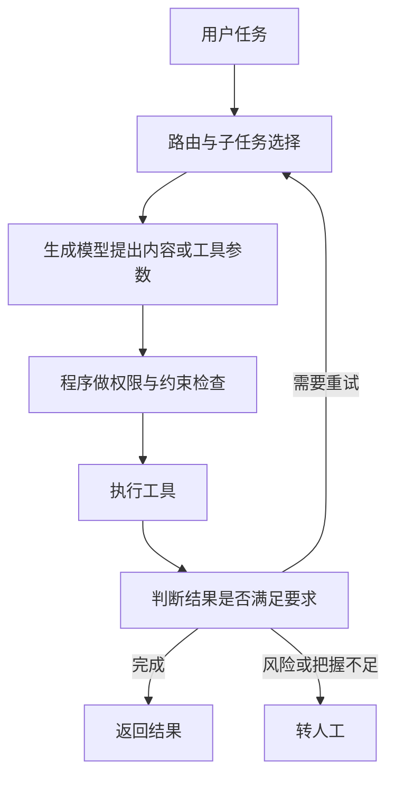

这个流程里，模型可以帮助做路由、护栏和验证；硬约束仍应由程序执行，阈值则应在目标业务上验证。概率格式方便工程接入，但模型必须知道什么、能判断什么、概率是否可靠，仍需要分别确认。

Jev 的启发在于把“判断”作为独立任务来设计接口、数据与训练目标。本轮开源实验进一步显示：专门训练与接口适配是不同路线；减少文本生成可能改善某些请求的成本和耗时，但不会自动提高规划质量。对校准价值的验证，应依赖独立结果和受控消融，而不只依赖一个小模型胜过大模型的展示。

## 资料、数据与复现入口

本文的实验数字来自仓库内固定结果，不是本次写作重新运行模型。版本、权重 SHA-256、数据修订和环境差异见实验 README。

- [原版 65 页 slide](slides/deck.html)、[逐页详细讲稿](演讲稿-逐页详细版.md)、[服务器实验讲稿](演讲稿-服务器实验补充.md)。
- [本轮实验报告与版本信息](../../experiment/nanojev_compare/README.md)。
- [96 条逐题预测](../../experiment/nanojev_compare/results/paired_predictions.jsonl)与[机器汇总](../../experiment/nanojev_compare/results/summary.json)。
- [同提示接口对照汇总](../../experiment/nanojev_compare/results/matched/systemone_chat_summary.json)与[提示审计](../../experiment/nanojev_compare/results/matched/prompt_audit.json)。
- [完整任务复跑轨迹](../../experiment/nanojev_compare/results/rollout_repeat/episodes.jsonl)与[复跑清单](../../experiment/nanojev_compare/results/rollout_repeat/manifest.json)。
- [接口与轨迹验证](../../experiment/nanojev_compare/results/interface_validation.json)、[网页验证记录](../../experiment/nanojev_compare/results/report-slides/verification.json)。
- [TypeSafe 发布文](https://typesafe.ai/blog/introducing-system-one-models-and-jev)、[官方训练概念说明](https://docs.typesafe.ai/introduction/machine-learning-primer.md)、[接口原语](https://docs.typesafe.ai/primitives.md)。
- [SGLang Decision models / System One 官方文档](https://docs.sglang.io/docs/supported-models/decision_models#system-one-compatible-api)与[源码仓库](https://github.com/sgl-project/sglang)。
- [历史数字与评测出处核查](notes/技术事实核查.md)、[上游项目分析](../开源项目分析.md)。

图示以 Mermaid 编写，可在 GitHub 的 Markdown 页面直接查看。训练机制和模拟器示意用于教学；它们不构成对 Jev 内部实现的确认。
